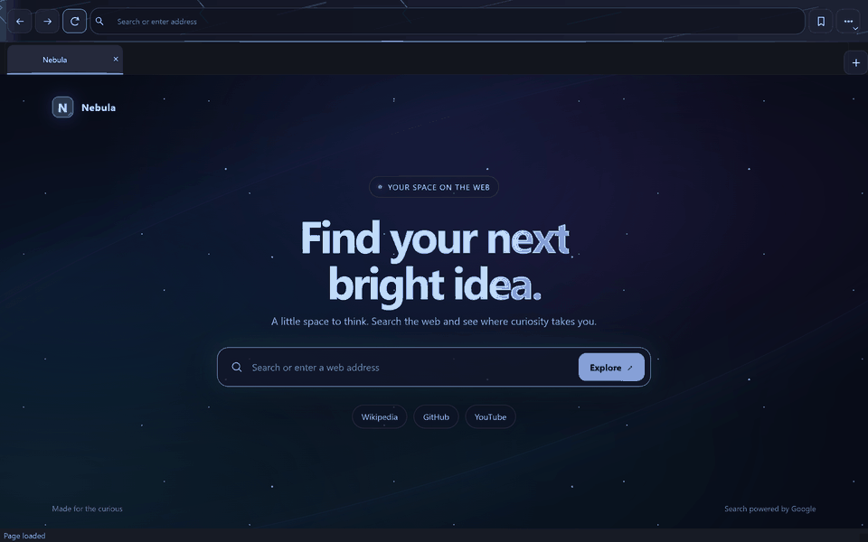
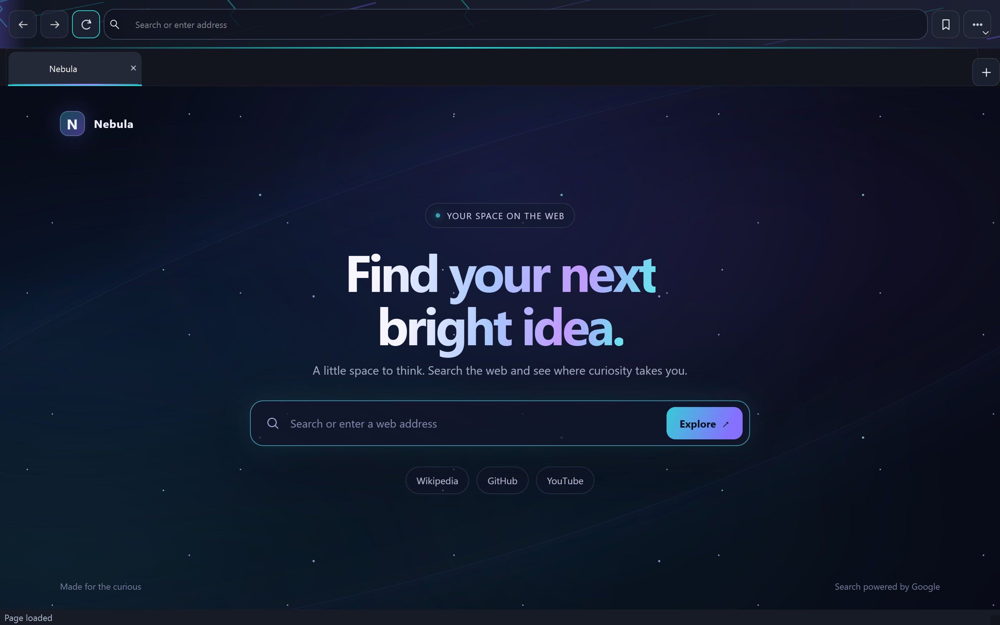
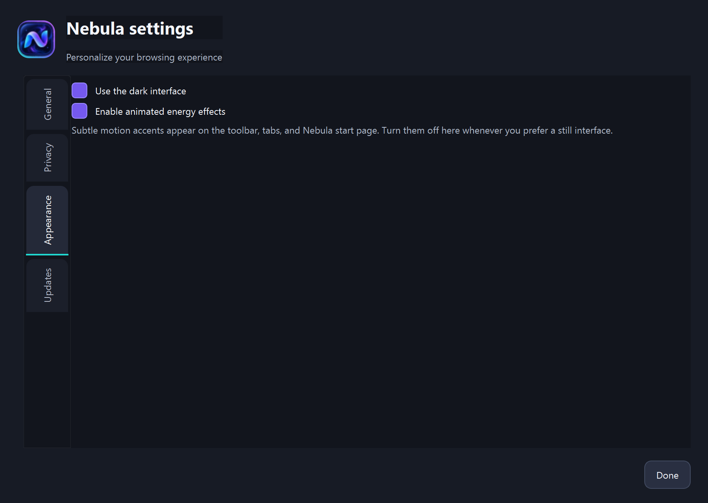

# Nebula

[](https://github.com/This-is-NB/PySurf/actions/workflows/tests.yml)
[](LICENSE)
[](pyproject.toml)

Nebula is a Python-only desktop browser built with PySide6 and Qt WebEngine
(Chromium). Its code is organized as a small package so application startup,
browser UI, privacy controls, persistence, settings, and updates have separate
responsibilities.

## Features

- Tabbed browsing with movable tabs, close buttons, duplicate, and restore-closed-tab actions.
- A custom Nebula start page with web search, quick links, and an animated space background.
- Bookmarks, browsing history, downloads, and session restoration.
- Private windows that do not save browsing history or session tabs.
- Light and dark themes, page zoom, and reduced-motion controls.
- Basic third-party tracker blocking and per-site permission prompts.
- Controls to clear history, cache, and cookies.
- Qt WebEngine update checks from the browser settings.

## Project layout

```text
main.py                 Compatibility launcher
pysurf/
  app.py                Application composition and startup
  browser.py            Browser window and tab workflows
  chrome.py             Animated toolbar and hover controls
  config.py             Settings and platform data paths
  dialogs.py            Settings, history, bookmark, and find dialogs
  home.html             Animated Nebula start page
  icons.py              Original vector browser icons
  migration.py          One-time legacy data migration
  navigation.py         Address parsing and search
  privacy.py            Chromium profiles and request filtering
  storage.py            SQLite history, bookmarks, and sessions
  theme.py              Shared light/dark design system
  updater.py            Qt WebEngine package updater
tests/
  test_config.py
  test_migration.py
  test_navigation.py
  test_storage.py
```

The application entry point composes settings and storage once and injects
those services into the browser window. UI dialogs, privacy/profile setup,
navigation parsing, and theme styling are isolated in their own modules.

## Interface

The navigation row is intentionally icon-only; hover labels and keyboard
shortcuts provide context without taking address-bar space. Library actions,
zoom, privacy mode, appearance, and settings are grouped in the browser menu.
The Nebula start page features an animated, space-inspired background and quick
web search. Settings are organized into General, Privacy, Appearance, and
Updates pages.
The toolbar and active-tab underline use original, abstract energy-streak
animations. Turn all motion off in **Menu → Settings → Appearance**.

Useful shortcuts: `Ctrl+L` address bar, `Ctrl+T` new tab, `Ctrl+W` close tab,
`Ctrl+F` find, `Ctrl+H` history, `Ctrl+D` bookmark, and `Ctrl+Shift+P` private
window.

## Screenshots and animations

The Nebula start page combines a drifting starfield, softly moving nebula
clouds, a pulsing accent, and subtle entrance and hover transitions. The
toolbar and active-tab indicator add lightweight motion throughout browsing.
Disable these effects in **Menu → Settings → Appearance**; the start page also
respects the operating system's reduced-motion preference.







## Install and run

Use the project virtual environment so the interpreter running Nebula also has
Qt WebEngine installed:

```powershell
pipenv install
pipenv run python main.py
```

Or install the package with pip:

```powershell
python -m pip install -e .
python main.py
```

The `pysurf` command and `python -m pysurf` entry points are also available
after installation.

## Tests

```powershell
python -m unittest discover -s tests
```

The persistence and configuration tests use temporary directories and do not
modify browser data.

## Contributing

Contributions are welcome. Start with the guide in
[CONTRIBUTING.md](CONTRIBUTING.md), browse issues marked **good first issue** or
**help wanted**, and open an issue before making large or behavior-changing
proposals. Bug reports and feature requests can be submitted with the GitHub
issue forms.

Maintainers can use [docs/REPOSITORY_SETUP.md](docs/REPOSITORY_SETUP.md) for
recommended repository topics and release-tag instructions.

## License

Nebula is distributed under the [MIT License](LICENSE).

## User data and privacy

Settings, SQLite data, Chromium cache, and persistent web storage are stored in
the platform's per-user application data directory. Set `PYSURF_DATA_DIR` to
override it. On first startup, Nebula copies compatible database, settings, and
web-storage data from the earlier repository-local `PySurfData` directory;
the original files are left untouched.

Private windows use off-the-record profiles and do not save browsing history or
session tabs. The built-in tracker filter blocks a short list of hostnames; it
is not comprehensive tracking protection. Qt WebEngine supplies Chromium's
process isolation and sandboxing.

## Chromium / Qt WebEngine updates

The updater upgrades `PySide6` and `PySide6-WebEngine` from PyPI, then offers to
restart the browser. The WebEngine wheel carries its Chromium build; this is a
package update, not a standalone Chromium downloader. Keep Nebula's dependencies
updated through Pipenv or pip as well.
